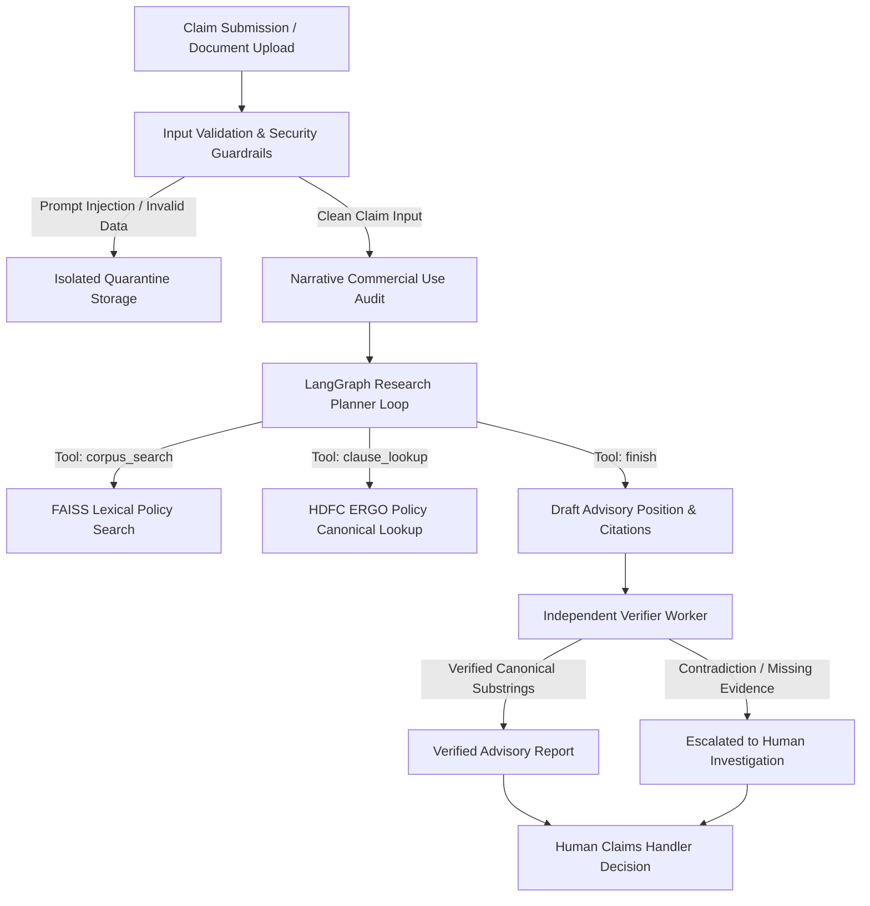

# MLSAD MINI PROJECT — Motor Insurance Claim Intake and Triage AI Agent

**Motor Insurance Claim Intake and Triage AI Agent · UE24AM342AA5**

This repository contains a full-stack, enterprise-grade AI claims analysis system for motor insurance First Notice of Loss (FNOL). It processes incoming claims, validates inputs with security and lexical guardrails, investigates the official **HDFC ERGO Private Car Package Policy** with model-chosen read-only tools, verifies cited clauses in an independent verifier worker, and routes claims to fast-track, surveyor assignment, or human investigation.

> **CRITICAL COMPLIANCE NOTICE**:
> The AI agent produces **advisory recommendations only**. A human claims handler makes every final coverage decision. The agent cannot approve, reject, or settle a claim.

---

## Key Features

1. **Enterprise Browser Interface (`/client`)**:
   - Modern, responsive Dark / Light mode dashboard.
   - Comprehensive FNOL claim submission interface with real-time chronology and data validation.
   - Supporting document upload (PDF/TXT repair estimates) with text extraction and field prefilling.
   - **Real-Time Agent Execution Stepper**: Interactive visual pipeline mapping the 11 real agent workflow stages with live Server-Sent Events (SSE) and telemetry streaming.
   - Comprehensive Advisory Results Screen: Displays coverage position, triage queue, exact supporting policy quotes (with page and clause IDs), narrative conflict analysis, and human handler action checklists.
   - Security Quarantine Inspector: Isolated diagnostic storage for prompt injection and malformed inputs.
2. **Dual Model Architecture**:
   - **Local Model**: Local Qwen2.5 1.5B GGUF served via an OpenAI-compatible llama.cpp endpoint (zero hosted API key needed).
   - **Google Gemini API**: Native Google Gemini integration (`gemini-2.5-flash` or custom models) using the official Google Gen AI SDK.
   - **Deterministic Stub**: Delayed reproducible test harness for automated system regression suites.
3. **Independent Verification & Guardrails**:
   - Input guardrails detecting prompt injection, toxic language, and determination tampering.
   - Separate verification worker verifying exact canonical source substrings against policy PDFs.
   - Human review and escalation routing whenever evidence is incomplete or contradictory.

---

## Quick Start & Local Execution

### 1. Environment Setup

Create a Python 3.9+ virtual environment and install the verified dependencies:

```bash
python3 -m venv .venv
source .venv/bin/activate
pip install -r requirements.txt
```

### 2. Configure Environment Variables

Copy `.env.example` to `.env`:

```bash
cp .env.example .env
```

#### Option A: Running with Google Gemini API

Set the following in `.env`:

```ini
MODEL_PROVIDER=gemini
MODEL_MODE=gemini
GEMINI_API_KEY=your_actual_gemini_api_key_here
GEMINI_MODEL=gemini-2.5-flash
SAFETY_REQUIRED=false
USE_FAKEREDIS=true
```

> **Privacy Warning**: Only synthetic claim data should be used. Never submit confidential personal identification or real policyholder information to external model endpoints.

#### Option B: Running with Local Qwen Model (Docker / llama.cpp)

Set the following in `.env`:

```ini
MODEL_PROVIDER=local
MODEL_MODE=live
MODEL_URL=http://127.0.0.1:8003/v1/chat/completions
MODEL_ID=local-planner
INPUT_USD_PER_MILLION=0
OUTPUT_USD_PER_MILLION=0
```

Start the local llama.cpp / Qwen service as documented in `docs/NATIVE_RUNTIME.md` or via Docker Compose:

```bash
docker compose --profile local-model up --build
```

#### Option C: Running with Deterministic Stub (Zero Setup)

For immediate offline demonstration and testing:

```ini
MODEL_PROVIDER=stub
MODEL_MODE=stub
MODEL_URL=http://127.0.0.1:8001/v1/chat/completions
SAFETY_REQUIRED=false
USE_FAKEREDIS=true
```

---

### 3. Start the Backend and Browser Client

Start the application API service:

```bash
# In active virtual environment (.venv):
python -m uvicorn app.api:app --host 127.0.0.1 --port 8000
```

If testing in stub mode without a separate model service running, you can also launch the stub in another terminal:

```bash
python -m uvicorn app.stub:app --host 127.0.0.1 --port 8001
```

Open your browser and navigate to:

👉 **[http://127.0.0.1:8000/client](http://127.0.0.1:8000/client)**

---

## Submitting Claims & Viewing Real Execution

### Via Web Browser Client (`/client`)

1. **Dashboard**: View live metrics on processed claims, queue distributions, and agent health.
2. **Submit Claim**:
   - Click "Submit Claim" in the sidebar.
   - Use one of the representative preset buttons (e.g. **"Load: Normal Claim"**, **"Load: Food Delivery (Concern)"**, **"Load: Total Loss"**, or **"Load: Injection Attack"**).
   - Alternatively, drag and drop a repair estimate or policy statement into the file dropzone to auto-extract repair amounts and vehicle details.
   - Click **"Submit Claim to Agent"**.
3. **Execution Visualization**:
   - The interface switches automatically to the **Agent Execution** view.
   - Watch the 11 real execution stages light up as events are streamed live via Server-Sent Events (SSE).
   - Inspect the live telemetry log showing exact tool queries, FAISS passage retrieval, and verifier audits.
4. **Advisory Results**:
   - Click **"View Advisory Results"** to review the advisory recommendation, triage queue (`fast-track`, `surveyor assignment`, or `investigation`), exact policy clauses, quoted claimant phrases, and claims handler checklist.
   - Download the full JSON advisory report or print the assessment.

### Via Terminal CLI

The terminal client remains fully functional:

```bash
# Interactive conversational intake:
python -m app.cli --api-url http://127.0.0.1:8000 chat

# Run synthetic JSON example:
python -m app.cli --api-url http://127.0.0.1:8000 run examples/valid.json --allow-stub
python -m app.cli --api-url http://127.0.0.1:8000 run examples/paraphrased_delivery.json --allow-stub
```

---

## Agent Workflow & Triage Architecture



### The 11 Processing Stages

1. **Claim Received & Contract Validation**: Validates strict FNOL chronology (`loss_date <= reported_date <= today`), vehicle registration format, and field bounds.
2. **Input Security & Lexical Guardrails**: Screens input text against prompt injections, toxic patterns, and determination tampering.
3. **Narrative & Vehicle Use Audit**: Inspects claimant narrative for commercial food delivery or hire/reward phrases that conflict with declared vehicle use.
4. **Policy Corpus Retrieval (FAISS)**: Executes lexical searches over the HDFC ERGO Private Car Package Policy document.
5. **Exact Clause Verification & Lookup**: Resolves exact clause IDs, document names, and PDF page numbers.
6. **Evidence & Policy Comparison Synthesis**: Cross-checks facts against Section I (Own Damage), Section II (Third Party), and General Exclusions.
7. **Claim Classification & Scope Assessment**: Categorizes claim as own damage, third party liability, theft, or total loss.
8. **Advisory Recommendation Generation**: Synthesizes coverage position (`potentially_covered`, `coverage_concern`, `insufficient_evidence`) and queue routing.
9. **Independent Citation Verifier**: Audits exact quotes against canonical text, verifying that no hallucinations occurred.
10. **Triage Routing Decision**: Assigns claim to Fast-Track (small personal repair at network garage), Surveyor Assignment, or Investigation.
11. **Advisory Hand-Off & Human Review Path**: Generates human handler checklist, limitations, and decision caveats.

---

## Running the Automated Test Suite

All 72 tests across unit, integration, security, and end-to-end suites pass:

```bash
# In active virtual environment:
pytest tests/ -v
```

Test coverage includes:
- `tests/test_api.py`: Core API endpoints, queue contracts, and error handling.
- `tests/test_api_extensions.py`: Dashboard statistics, run indexing, quarantine inspector, and document extraction.
- `tests/test_gemini.py`: Gemini provider flag handling, missing key safeguards, and structured output formatting.
- `tests/test_end_to_end_flow.py`: Full end-to-end user workflow from submission to trace and feedback.
- `tests/test_system.py`: LangGraph execution graphs, policy search, and verifier logic.
- `tests/test_hardening.py`: Prompt injection resilience and boundary checks.
- `tests/test_research_agent.py`: Tool calling, memory bounds, and narrative auditing.
- `tests/test_trace_quality.py`: Telemetry and OpenTelemetry tracing.

---

## Troubleshooting

| Issue | Cause | Solution |
| --- | --- | --- |
| `HTTP 422: Input rejected ... Quarantine ID: ...` | Prompt injection pattern or malformed data detected by guardrails. | Inspect the quarantine ID on `/client` under the **Quarantine** tab to view the diagnostic record. |
| `ProviderUnavailable: GEMINI_API_KEY is not configured` | `MODEL_PROVIDER=gemini` was set without providing an API key. | Add your key to `GEMINI_API_KEY` in `.env` or set `MODEL_PROVIDER=stub`. |
| `Corpus index missing` on `/health` | The FAISS index has not been built. | Run `python -m app.retrieval` to index `corpus/hdfc_private_car_package.pdf`. |
| Port 8000 in use | Another service is using port 8000. | Start Uvicorn on another port (e.g. `--port 8080`) and open `http://127.0.0.1:8080/client`. |
