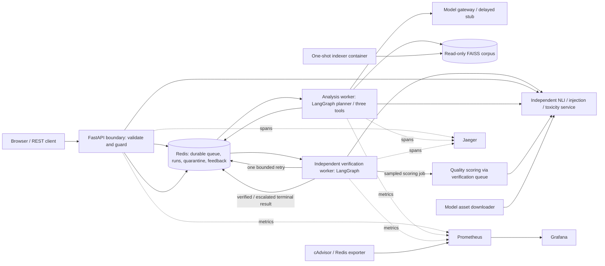

# MLSAD MINI PROJECT

Motor Insurance Claim Intake and Triage - UE24AM342AA5, Mini Project 01.
Report updated 17 October 2026. Repository: https://github.com/DarkTJ7/MLSAD-MINI-PROJECT

## Scope and deliverable status

This is a tested local advisory service for one private-car package corpus. It
validates FNOLs, classifies claims, retrieves cover and modifying restrictions,
verifies evidence, and recommends an operational queue. A human always decides;
no approval/rejection or settlement calculation is allowed. The package includes
source, plan, corpus, data contracts, prompts, evaluation, report, runbook, genuine
incidents, deployment configuration and demonstration instructions.

Completed local evidence: 39 passing regression tests; 12/12 independent
classifier/NLI smoke checks; actual HTTP demonstrations; real local-model prompt
comparison on 24 fixed scenarios per variant; nine baseline native load/scaling/cache trials
and four matched post-fix native validations;
connected trace and sampled live quality evidence. Docker measurements and actual
container dashboard startup remain pending by explicit agreement with the user.
Finite tests do not establish universal security or legal correctness.

## Corpus and reference case

HDFC ERGO Standard Form for Private Car Package Policy: official historical PDF,
nine pages. PDF page 1 supplies the insurer FAQ/claims procedure; pages 2-9 contain
policy wording and endorsement catalogue. Provenance, pinned hash, extracted
procedure and reference passages are supplied. Faculty must confirm that this
embedded procedure meets the two-document requirement. It is not current product
advice; the customer's schedule and activated endorsements are absent.

Food-delivery case: retrieve accidental-damage cover plus the FAQ hire/reward
passage and General Exception/use clause. Recommend coverage_concern and
investigation with human schedule review. The narrow semantic claim is that the
policy restricts vehicle use, not that every delivery claim is definitively excluded.
Native HTTP evidence contains both ordinary and delivery cases with resolving
citations. See PROJECT_PLAN.md and reference_answer.json for proposed faculty
confirmation and exact values.

## Architecture, agents and design choices

Each service box is a deployment boundary. API serves the browser and returns 202
with a run identifier; Redis separates intake from two independently running worker
roles. Analysis uses LangGraph to select request_fields, corpus_search and
clause_lookup. It reads apparent cover, follows terms/exceptions/conditions using
a further search, and drafts a constrained recommendation. Verification has its
own LangGraph, canonical source checks and independent learned entailment service.
It can refuse the draft, request one retry, then escalate. A queued quality job
samples completed results without delaying the intake response.

The real generative model chooses allowed planner actions through a constrained
JSON schema. A compulsory single-choice field read does not waste a model call.
Classification/entity rules and draft templates remain deterministic: this is
not a claim that a small model provides unrestricted legal reasoning. Prompts
are versioned and every call records usage/cost. Steps, tools and wall time are
bounded; the gateway has HTTP timeouts, three attempts, backoff and a shared
circuit breaker. Unfinished or unsupported work returns explicit escalation.

Retrieval uses LangChain and FAISS with 1000-character page-local chunks, 180
overlap and local word/bigram hashing embeddings. This is a lightweight lexical
baseline; it is not a semantic sentence-transformer index. Separate sentence
embeddings score live context relevance. Content hashes make indexing idempotent;
embedding/query caches and --reembed support updates. Source PDF/page/chunk
identifiers accompany citations. The fast-track threshold of 20000 is an explicit
operational demo assumption, not an insurer entitlement.

Rejected synchronous reasoning in POST, notebook-only execution, single-pass
retrieval, unconstrained tool execution and automated claim determinations.
Polling avoids callback credentials/network retries in a local demo. Separate
workers allow failure isolation and scaling; measurements demonstrate why the
verifier must also be considered when scaling analysis. Deployment is localhost
only; authentication/TLS, real policy lookup and production retention require work.

## Real-model comparison and evaluation

Actual CPU llama.cpp runtime and a free small GGUF instruction model were used;
binary/model hashes, source revisions and configuration are in results/REAL_MODEL.md
and model provenance JSON. Both variants ran the same 24 synthetic reference
scenarios. v1 searches apparent cover; v4 adds modifier search, source lookup,
explicit tool descriptions, source identifiers and stage-specific research objectives.
Independent safety/NLI was required. Variants used the same local server; their timings are quality-experiment observations, not SLO measurements.

| Metric | Real v1 | Real v4 |
|---|---:|---:|
| groundedness (proxy) | 100.00% | 100.00% |
| context_relevance (proxy) | 34.14% | 23.76% |
| faithfulness (proxy) | 79.17% | 70.83% |
| hallucination_rate (proxy) | 0.00% | 0.00% |

Structured outcome agreement: v1 79.17%, v4
70.83%; difference
-8.33 percentage points.
On this metric, v1 performed better. Verified fractions are
62.50% and 54.17%, respectively.
Do not replace these real results with the earlier historical 24/24 stub result.
The earlier real v1/v2 experiment is preserved in real_before_fix/: v1 matched
19/24 outcomes, while v2 matched 12/24 and prematurely escalated nine scenarios.
The v3 experiment matched only 9/24 and is also preserved.
Both current variants were rerun with the same clause-preserving NLI input;
the historical regression was not hidden by editing an old prompt artifact.

Proxy definitions: groundedness is exact citations resolving to retrieved text;
context relevance is frozen-reference chunk overlap; structured faithfulness is
exact classification/position/queue agreement; citation hallucination is unsupported
citations. No-citation abstentions are excluded from citation denominators, not
given perfect scores. All 24 enter structured agreement. Gold labels were prepared
from the corpus/demo rules and still need independent domain confirmation.

| Independent semantic metric | Real v1 | Real v4 |
|---|---:|---:|
| groundedness | 96.84% (n=15) | 96.99% (n=13) |
| context_relevance | 0.121 (n=20) | 0.113 (n=19) |
| faithfulness | 100.00% (n=15) | 100.00% (n=13) |
| hallucination_rate | 0.00% (n=15) | 0.00% (n=13) |

Learned scores add a separate check: groundedness is mean supported-proposition
entailment probability; faithfulness is supported fraction; unsupported-proposition
rate is its complement; context relevance is sentence-embedding cosine. Abstentions
have null proposition scores. Denominators are shown because safe refusal can
improve apparent supported-answer quality while reducing useful answers. Models
can err on legal language; these are indicators, not insurer-certified accuracy.

## Native performance, scaling and cache evidence

The p95 target was declared before measurement: <=30 seconds submission-to-terminal
at five clients with a 350 ms stub, plus >=95% verified valid recommendations.
Hard stub deadline is 45 seconds. The native matrix used actual API, Redis,
separate analysis/verification processes and learned safety/NLI, with no concurrent
generative-model evaluation. Locust RUN rows measure complete runs; POST/GET
latencies and aggregate HTTP request rates are not substituted for run metrics.

| Workers | Cache | Clients | Verified/terminal | Verified RUN/s | p50 s | p95 s | SLO met |
|---:|:---:|---:|---:|---:|---:|---:|:---:|
| 1 | on | 1 | 17/17 | 0.272 | 3.12 | 3.65 | yes |
| 1 | on | 5 | 25/25 | 0.349 | 12.77 | 16.44 | yes |
| 1 | on | 10 | 29/29 | 0.417 | 20.58 | 27.08 | yes |
| 1 | on | 20 | 32/44 | 0.310 | 43.58 | 46.10 | no |
| 3 | on | 5 | 31/31 | 0.433 | 9.34 | 12.75 | yes |
| 3 | on | 10 | 35/35 | 0.432 | 21.16 | 24.13 | yes |
| 3 | on | 20 | 29/44 | 0.296 | 40.99 | 47.30 | no |
| 1 | off | 5 | 31/31 | 0.458 | 10.04 | 12.84 | yes |
| 3 | off | 5 | 32/32 | 0.485 | 8.85 | 12.88 | yes |

1 worker(s), 5 clients: cache-on p95 16.44 s versus off 12.84 s; observed change +28.0%. API charge per run: USD 0 in both. Single exploratory trials; do not infer a statistically significant caching benefit.

3 worker(s), 5 clients: cache-on p95 12.75 s versus off 12.88 s; observed change -1.1%. API charge per run: USD 0 in both. Single exploratory trials; do not infer a statistically significant caching benefit.

Both worker counts first miss the target at the tested concurrency of 20; 10 passes. The actual boundary is only bracketed, not exactly located. Three analysis workers help at five/ten clients but do not remove the single verification queue and learned-inference bottleneck. Per-phase timings and their sample counts are in summary.json. Deadline escalations are counted as failures, not successful recommendations. Native startup issue and initial attempt are retained in incident_log.md and native_load_attempt1/. Docker measurements remain pending.

Evidence identifies the queue bottleneck. At 20 clients, median analysis queue wait
fell from 34.84 s with one worker to 2.37 s with three. Median verification queue
wait rose from 3.24 s to 25.04 s. Verification execution stayed around 1.6-1.7 s.
Adding analysis capacity feeds the single verifier faster; it does not give a
threefold platform speedup. At five clients p95 improves, while at 20 clients
successes and tail latency worsen. Further work should test extra verification
capacity and shared inference throughput rather than blindly adding analysis.

These are single exploratory trials, not confidence intervals. Cache ordering,
background load and sampled quality jobs limit causal interpretation. The query
cache did not demonstrate a reliable end-to-end p95 benefit. All local API charges
were zero; CPU, electricity and memory are not priced. Native runtime source commit
is recorded; final type/tracing refinements were separately regression tested.
Docker/Desktop results must be measured separately and cannot be inferred here.

Post-fix native validations are recorded separately in
results/native_load_after_verifier_fix/. They measure the final focused-clause
verifier at five and twenty clients with one and three analysis workers. Read
results/NATIVE_AFTER_FIX.md for those results:

| Workers | Clients | Verified/terminal | Successful RUN/s | p50 s | p95 s | SLO met |
|---:|---:|---:|---:|---:|---:|:---:|
| 1 | 5 | 26/26 | 0.356 | 12.58 | 19.00 | yes |
| 1 | 20 | 26/42 | 0.260 | 43.94 | 46.31 | no |
| 3 | 5 | 67/67 | 1.072 | 3.85 | 6.49 | yes |
| 3 | 20 | 80/80 | 0.933 | 17.71 | 26.17 | yes |

Source commit: be78857129b2f1151a8f3c19628653d8b9c18698. The baseline nine-trial matrix and cache comparisons remain in native_load/ and NATIVE_MEASUREMENTS.md. These four matched validations use focused, complete policy clauses for NLI. At three workers the tested20-client case now meets the target; this does not locate the next failure point. One worker still has its observed latency limit. No zero-charge local API result prices CPU/electricity. Single trials, no confidence intervals.

 the baseline table above is not
silently relabelled as final-code performance. The historical queue bottleneck
guided the verifier's clause-context correction as well as its quality fix.

## Semantic, security and observability implementation

Verification resolves every quote against both retrieved and canonical source
text, validates advisory flags/route/template, and requires independent NLI for
controlled coverage propositions. Input screening normalises Unicode, invisible
formatting, HTML/URL escapes and printable base64, then applies lexical policy and
an independent injection classifier to every free-text field and retrieved passage.
Overlapping windows cover text tails. Tools are read-only and allowlisted. Output
passes toxicity/determination filters and cannot introduce arbitrary new narrative
or disable human review. Missing required safety infrastructure fails closed by default. Immutable-policy
preflight screened 83 chunks in 188.82 seconds; five classifier flags were retained,
not silently treated as safe. Relevant flagged passages still cause abstention.
These mechanisms are implemented; no classifier provides universal attack defence.

W3C trace context crosses Redis handoffs and HTTP calls. API, analysis, verification,
safety, model-stub and quality spans can share one trace ID; run/correlation IDs
are retained. The native span export proves parent relationships; OTLP/Jaeger is
configured for Docker. Structured events retain tool calls, queries, passages,
prompt version, timing, actual generation tokens/cost and verification outcomes.

Prometheus/Grafana configuration supplies agent task success, steps/tools/retries,
latency/throughput/errors, availability and cAdvisor per-container CPU, memory,
uptime, disk/network plus Redis metrics. Dashboard execution on Docker remains
pending. Persisted feedback is separate from automatically sampled live quality;
the web client charts the four learned quality indicators over recent runs.

## Cost, failures and assessment preparation

Local generative API cost per 100 runs is USD 0 for both variants. Actual prompt
and completion tokens are recorded per call/run; no paid provider was used.
There is no nonzero API cost driver to rank. Compute latency is dominated by
planner generation and learned verification; cloud-provider cost must be measured
with that provider's actual usage/prices if substituted.

Genuine incidents include the RQ timeout-argument bug, empty bearer header,
native RESP mismatch, a classifier false positive on benign output, cold-worker
readiness and an overstrong unsupported delivery proposition. Fixes and evidence
are in incident_log.md; failed native warmup evidence was preserved. The baseline terminal-state audit corrected one
reported verified count from 36/44 to 32/44; original CSV and excluded IDs remain.
After the fix there were zero such inconsistencies in four validation trials. Missing
Docker networking was not disguised as a successful Docker run.

Before assessment: confirm corpus/reference with faculty, add team names,
install/start Docker Desktop Linux engine, rehearse clean-clone startup and all
ten demonstration items, execute container load/cache/scaling and dashboard tests,
and retain that separate evidence. Default stub is for smoke/performance testing;
use the local-model profile for assessed generative-agent reasoning. The optional
container model profile downloads pinned model data and is unexecuted here.
See README, HARDENING, NATIVE_DEMO, DEMO_AND_VIVA and REQUIREMENTS for exact scope.
