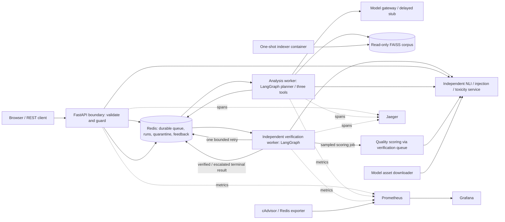

# Architecture and decisions

The current v5 behavior is documented in [the agent guide](AGENT_GUIDE.md).
Its research worker includes a model-assisted narrative-use audit with an exact
claimant quote, model-written search queries and an explicit modifier-search
gate for restricted-use cases. The independently deployed verifier remains a
separate worker. Older step and deadline figures below describe the original
stub-oriented design; v5 uses 14 research decisions, 10 tool calls and a
360-second local-model run deadline. See [the peer design comparison](REFERENCE_AGENT_COMPARISON.md)
for the distinct approach adopted in this project.

Each named service in Compose is a deployment boundary. Browser assets are served
by API. Redis separates latency-sensitive ingestion from variable-time reasoning.
Analysis and verification are distinct queue consumers in separate containers;
they have separate code/graphs and responsibility, not just separate prompts.
Scale analysis with `docker compose up --scale agent-worker=3`.
Verifier can be scaled independently. Indexer has a different, batch resource
profile and publishes before readers start. No host model or host queue is needed.

## Agent hand-off and bounded behaviour
Planner selects only allowlisted tools: request_fields, corpus_search, clause_lookup.
Graph: plan -> chosen tool -> plan -> draft; maximum 10 planner steps, 7 tool calls,
45 second deadline from acceptance, 8 second maximum HTTP provider call, 3 attempts
with 0.1/0.2 second backoff. Search is an agent-selected call. Modifier query follows
"subject to terms/exceptions/conditions" in the retrieved cover. Deterministic
stub implements this policy; live JSON planner can replace it by configuration.
Drafting and verification are rule based. There is no claim of unrestricted LLM
reasoning. Verification now additionally requires independent learned entailment
in the default deployment; see HARDENING.md for proposition scope and thresholds.

Analysis serialises state and passages into verification queue. Verification checks
source identity, page, exact quote, mandatory concepts, risk/position consistency,
output guard and output schema. Unsupported results request one v2 modifier retry
then escalate. RQ retains jobs; a worker failure may leave a started job in the
failed registry. Polling enforces the absolute deadline and returns an explicit
escalation even if the worker died. A crash does not become a confident result.
Automatic job reclaim and exactly-once finalisation are not production-complete.

## Retrieval
LangChain RecursiveCharacterTextSplitter: 1000 characters, 180 overlap, page-local
chunks. Store full source PDF, digest, PDF page and stable chunk identifier. These
are passage identifiers, not invented insurer clause numbers. LangChain FAISS
vector store uses 1024-dimensional local word/bigram hashing embeddings. This
zero-download lexical baseline is a deliberate resource tradeoff; it is not a
sentence-transformer semantic model. A semantic embedding adapter and separate
clause-level segmentation are next improvements. Mandatory restriction queries
compensate partly for mismatch between accident and permitted-use vocabulary.

Index pipeline uses source fingerprints to skip unchanged corpora; content-keyed
embedding cache reuses unchanged chunks. `--reembed` regenerates vectors without
redownloading or reparsing the source manually. Corpus search has per-process
query cache. No whole-run cache: claim facts and audit identities remain distinct.
The immutable Corpus and a 128-query cache are reused within each worker process;
measure before claiming speedup. Rebuild index only while workers are stopped; atomic version
swap under simultaneous reindexing is not implemented.

## Choices rejected / limitations
Rejected notebook-only execution (no service contract), synchronous reasoning in
POST (long waits), single retrieval (misses use restriction), model-only citation
verification (cannot guarantee quote resolution), and automated claim decisions
(outside scope). Redis is simpler than Kafka for this small workload; FAISS avoids
an additional vector-database service. No cloud requirement.

Lexical guards are supplemented by independent injection/toxicity classifiers,
Unicode/encoding normalisation, complete overlapping text windows and constrained
tool actions/output templates. Classifiers retain language/domain limitations.
No authentication or TLS: localhost demo only. Never expose it publicly
or submit real personal data without adding access controls, retention policies,
PII redaction, hardened content isolation and security review. Corpus text is sent
to a live provider only if explicitly configured.

Tracing spans contain run_id and step attributes. W3C parent context is serialised
across both RQ handoffs and injected/extracted across safety HTTP calls. The
durable JSON run trace preserves evidence alongside the connected OTel spans.
Grafana has 28 panels, including cAdvisor container CPU/memory/uptime/network/disk,
Redis metrics and per-agent task/step/tool/retry/latency measures. Configuration is
complete; actual Docker exporter/dashboard integration remains unexecuted here.
