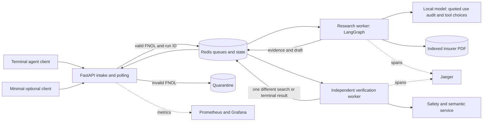

# AI agent architecture

The API validates schema, ranges, categories and date relationships before
enqueueing. It returns HTTP 202 plus a run ID, because local model runs can
take tens of seconds. Redis separates request latency from agent execution
and persists short-lived run state, quarantine records, rate limits and
feedback. The model, research worker and verifier have different CPU and
failure profiles. Research and verification are separate queue consumers,
not two prompts in one process.

## Research loop

The research worker uses the current v5 LangGraph only. A narrow model call
first audits narrative vehicle use and must quote the claimant's own phrase
for a delivery/hire-reward signal. The structured FNOL and this signal
determine evidence requirements. A second model call selects a read-only
tool and its argument. Search results are screened and stored with original
PDF page/chunk IDs. After apparent cover, the agent investigates exclusions,
vehicle-use restrictions and claim procedure. Restricted-use cases require
an explicit modifier search. It may inspect only IDs it has retrieved.

The output draft uses constrained advisory wording and operational rules.
This limits what the small model can claim. The model controls research,
not claim adjudication.

## Verification and failure

The verification worker receives the serialised run state through Redis.
It checks canonical PDF text, page, document, exact quote, mandatory concepts,
schema, safe wording and learned semantic support. A refusal can go back to
research once with specific feedback requiring a different search. If that
fails, the run escalates. Queue or model deadlines, safety-service failure,
provider circuit opening and out-of-corpus claims also escalate. A late
worker cannot overwrite an already terminal status.

The source PDF is indexed by an idempotent one-shot job using page-local
chunks and a local lexical hashing embedding baseline in FAISS. This is
not a semantic retrieval model. The index records PDF hashes, chunk count,
build time and throughput. The historical document and missing customer
schedule constrain any coverage statement.

## Observability and deployment status

Every run has a correlation/run ID, structured step events, model token and
API-cost records, retrieved passages, verifier outcome and a W3C trace
context across queue handoffs. Compose includes Prometheus, Grafana,
Jaeger, cAdvisor and a Redis exporter. The configuration is supplied;
Docker Desktop was unavailable during authoring, so full container dashboard
and scaling claims are pending live rehearsal. Local tests and selected
real-model traces are in [results](../results).

See [the interface contract](INTERFACES.md),
[requirement status](REQUIREMENTS.md) and [runbook](../runbook.md).
